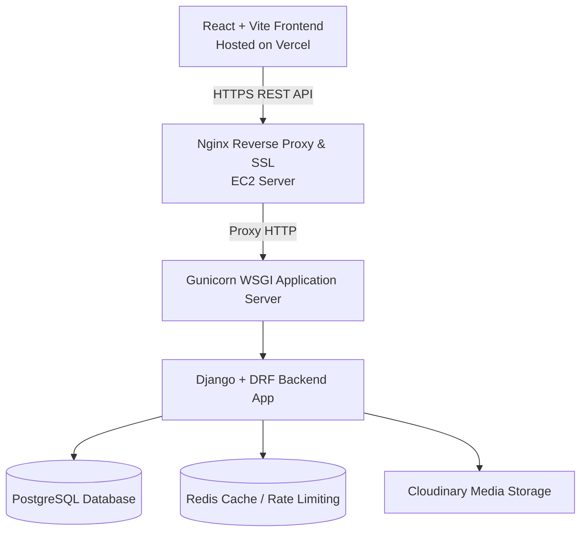

# Forguild - Phase 1: Product Requirements Document (PRD) & Architectural Strategy

> **Role**: Senior Software Architect, Senior Product Manager, Senior Full Stack Engineer  
> **Status**: Phase 1 - Requirements & Architecture Alignment  
> **Tagline**: Build Together. Grow Together.

---

## 1. Product Vision & Context

### 1.1 Product Vision
> Forguild is a collaboration platform where students, developers, designers, startup builders, innovators, and hackathon participants come together to discover opportunities, build high-performing teams, validate ideas, collaborate efficiently, and transform hackathon projects into real products and startups.

The primary value of Forguild is **people, teams, collaboration, and innovation**.

Events are only the starting point.

### 1.2 Core Value Proposition
- **Problem Addressed**: Hackathon attendees struggle to assemble balanced cross-functional teams (e.g., pairing a React developer with an AI engineer and UI/UX designer) and often abandon hackathon projects post-event due to a lack of team continuity tools.
- **Product Strategy**: Forguild serves as the premier **discovery, team-building, and idea validation engine**. Registration actions seamlessly redirect users to official organizer websites.

### 1.3 Core Brand Identity
- **Mission**: Help ambitious builders find the right teammates, participate in hackathons, validate ideas, and continue building successful products beyond competitions.
- **Core Values**: Collaboration, Innovation, Teamwork, Community, Learning, Startup Mindset, Continuous Growth.
- **Brand Personality**: Modern, clean, professional, minimal, trustworthy, and community-driven.
- **Future Positioning**: Forguild aims to evolve into the go-to platform for discovering hackathons, finding teammates, building startup ideas, and creating long-term collaborative communities.

---

## 2. Architecture Philosophy & Engineering Principles

Forguild adheres to the following core engineering principles:

- **Build an MVP First**: Focus strictly on essential discovery and collaboration capabilities for initial launch.
- **Avoid Unnecessary Complexity in Version 1**: Postpone heavy background services, AI engines, and complex real-time layers to Version 2+.
- **Prefer Modular Architecture**: Design Django backend applications with clean, decoupled domain boundaries (`accounts`, `events`, `teams`, `ideas`, `notifications`, `chat`).
- **Keep Every Module Independently Scalable**: Ensure services maintain loose coupling so individual components can scale or evolve independently.
- **Design the Database with Future Expansion in Mind**: Architect schemas to support future core features (e.g., Idea Hub) without requiring breaking schema migrations later.
- **Follow REST API Best Practices**: Use predictable endpoints, standardized HTTP status codes, structured JSON responses, proper pagination, and JWT authentication.
- **Follow SOLID Principles**: Enforce single responsibility, open/closed principles, and interface separation across code modules.
- **Prioritize Maintainability over Premature Optimization**: Focus on clean, documented, and well-tested code over complex early optimizations.

---

## 3. Registration Strategy

Forguild **never** hosts registrations natively on the platform.

Each event on Forguild contains:
- **Official Registration URL**
- **Official Website**
- **Organizer Information**

The **Register** button redirects users directly to the organizer's official website. Forguild provides **discovery and collaboration** only, leaving event management and ticket/registration processing strictly to external event organizers.

---

## 4. Core Functional Requirements

### 4.1 User Management & Auth (App: `accounts`)
- Custom User Model extending `AbstractUser` with email as primary login identity or unique username.
- JWT authentication (`django-rest-framework-simplejwt`) with HTTP-only Refresh Cookies or Bearer Tokens.
- Extended user profile containing:
  - Bio, location, contact information
  - **User Availability Options**:
    - `LOOKING_FOR_TEAM`
    - `LOOKING_FOR_STARTUP`
    - `LOOKING_FOR_COFOUNDER`
    - `TEAM_FULL`
    - `NOT_AVAILABLE`
  - Skill set tags & preferred roles (`FRONTEND`, `BACKEND`, `AI_ML`, `DESIGN`, `DEVOPS`, `PRODUCT`)
  - Social & portfolio links (`GitHub`, `LinkedIn`, `Portfolio URL`)

### 4.2 Event Discovery Engine (App: `events`)
- Browsing, search, and multi-faceted filtering (by Category, Mode: `ONLINE`/`HYBRID`/`IN_PERSON`, Location, Date Range, Prize Pool).
- **Standardized Event Categories**:
  - AI & Machine Learning
  - Web Development
  - Mobile Development
  - Cyber Security
  - Blockchain
  - Cloud Computing
  - IoT
  - Data Science
  - Open Source
  - Game Development
  - Healthcare
  - FinTech
  - Sustainability
  - Robotics
  - General
- Save / Bookmark events functionality.
- Redirection tracking to official organizer registration URLs (no internal registration intake).
- Event publishing channels: Admin created, Verified Organizers, and Community Suggested (pending admin verification).

### 4.3 Team Assembly & Recruitment (App: `teams`)
- Team creation associated with a specific event or open-ended startup project.
- Open role requirements (e.g., "Looking for 1 UI/UX Designer & 1 Smart Contract Dev").
- Membership workflow: Request to Join $\rightarrow$ Leader Review $\rightarrow$ Accept / Reject.
- Direct invitations from team leader to targeted users.
- Skill-overlap rule-based matching for V1 team discovery.

### 4.4 Core Module: Idea Hub (App: `ideas`) — *Version 2 Feature (Architectural Support in Schema)*
- **Purpose**: Allow users to publish startup ideas or hackathon ideas before forming a team.
- **Attributes per Idea**:
  - Title
  - Description
  - Problem Statement
  - Required Skills
  - Current Team Size
  - Looking For
  - Status (`Open` / `Closed`)
- *Architectural Note*: Included in the system architecture and database design phases to support future enablement without schema refactoring.

### 4.5 Deferred MVP Scope (Version 2 or Later)
To minimize initial complexity, the following features are explicitly postponed to V2 or later:
- **Real-time Chat**
- **Resume Upload**
- **AI Team Recommendation**
- **Email Notifications**
- **Advanced Analytics**

---

## 5. System Architecture & Technical Strategy

### Architectural Decisions & Trade-Offs

| Component | Choice | Trade-offs & Rationale |
| :--- | :--- | :--- |
| **Backend Framework** | Django + DRF | **Pro**: Built-in ORM, admin panel, robust authentication, security middleware. **Con**: Heavier footprint than FastAPI, but ORM and Admin speed up V1 backend delivery significantly. |
| **Auth Strategy** | SimpleJWT | Stateless access tokens (15-min expiry) paired with rotating refresh tokens stored securely. |
| **Database** | PostgreSQL | Relational integrity, JSONB support for dynamic metadata/tags, indexing on search fields. |
| **Asset Storage** | Cloudinary | Offloads user avatar uploads and event banner storage from EC2 disk storage. |

---

## 6. Phased Engineering Roadmap

- [x] **Phase 1: Product Requirements** *(Current)*
- [ ] **Phase 2: Database Design**
- [ ] **Phase 3: ER Diagram**
- [ ] **Phase 4: REST API Design**
- [ ] **Phase 5: Backend Development**
- [ ] **Phase 6: Frontend Integration**
- [ ] **Phase 7: Notifications**
- [ ] **Phase 8: Real-time Chat**
- [ ] **Phase 9: AI Features**
- [ ] **Phase 10: Production Deployment**

---

## 7. Architectural Review & Mentor Feedback

> [!TIP]
> **Key Architectural Principles for Phase 1 Alignment**:
> 1. **Registration Redirection Model**: Forguild never handles registration natively; all registration CTAs redirect users to official event sources.
> 2. **Modular Architecture**: Django apps (`accounts`, `events`, `teams`, `ideas`, `notifications`, `chat`) provide clean separation of concerns and maintainable domain boundaries.
